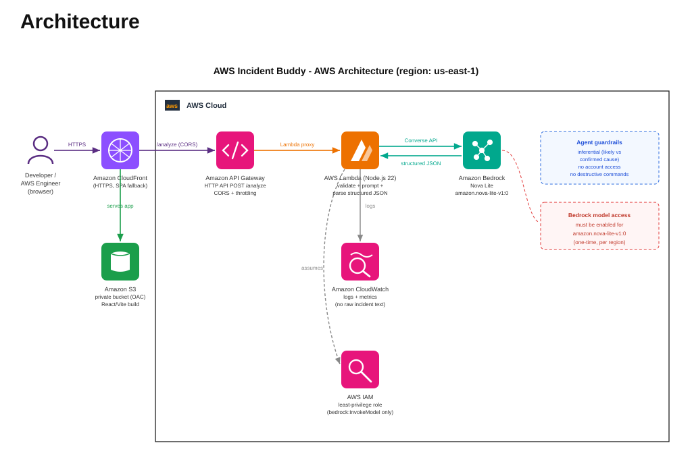

# AWS Incident Buddy

> Turn AWS errors into your next troubleshooting step.

AWS Incident Buddy is a small, production-quality AI agent. Paste an AWS error message, exception, CloudWatch log, or deployment failure, and it returns a structured analysis: the likely service, severity, a plain-language explanation, a likely (clearly inferred) root cause, safe troubleshooting steps, and what to check next — behaving like an AWS incident first responder, not a generic chatbot.

It never claims access to your AWS account, always distinguishes a **likely cause** from a **confirmed cause**, and warns you before you apply IAM or infrastructure changes.

---

## 1. Architecture Summary



```
User Browser
    │
    ▼
React SPA (Vite)  ── served from S3 + CloudFront (prod) or Vite dev server (local)
    │  POST /analyze  { "incident": "..." }
    ▼
Amazon API Gateway (HTTP API)
    │  Lambda proxy integration
    ▼
AWS Lambda  (Node.js 22.x)
    │  Converse API  (bedrock:InvokeModel)
    ▼
Amazon Bedrock  (amazon.nova-lite-v1:0)
```

- **Frontend** — React 18/19 + Vite, plain CSS. Pure static build.
- **Backend** — single Lambda function. Validates input, calls Bedrock via the Converse API, parses and validates the structured JSON, returns a stable response shape.
- **AI** — Amazon Bedrock Nova Lite. A strict system prompt forces structured JSON and enforces the "advisory, inferential, never destructive" behavior.
- **API** — API Gateway HTTP API (cheaper/faster than REST API), single `POST /analyze` route with CORS.
- **IaC** — AWS SAM (`template.yaml`), least-privilege IAM.

Deliberately **not** used (kept minimal): DynamoDB, Cognito, RAG, vector DBs, ECS, App Runner, Step Functions, multi-agent orchestration.

---

## 2. Files Created

```
awsincidentbuddy/
├── .kiro/specs/aws-incident-buddy/
│   ├── requirements.md          # functional + non-functional requirements
│   ├── design.md                # architecture, data contracts, prompt design, IAM
│   └── tasks.md                 # implementation task breakdown
├── template.yaml                # SAM: Lambda + HTTP API + least-privilege IAM
├── samconfig.toml               # SAM deploy defaults
├── .gitignore
├── README.md
│
├── backend/
│   ├── package.json             # @aws-sdk/client-bedrock-runtime
│   ├── src/
│   │   ├── config.js            # env-var configuration
│   │   ├── validator.js         # input validation + sanitisation
│   │   ├── prompt.js            # system prompt + user prompt builder
│   │   ├── bedrockClient.js     # Bedrock Converse API wrapper
│   │   ├── responseParser.js    # extract + validate model JSON
│   │   └── handler.js           # Lambda entry point
│   └── tests/
│       ├── validator.test.js
│       ├── responseParser.test.js
│       ├── handler.test.js
│       └── fixtures/sampleIncidents.json
│
├── frontend/
│   ├── index.html
│   ├── vite.config.js           # dev proxy /analyze -> localhost:3000
│   ├── .env.example             # VITE_API_URL
│   └── src/
│       ├── App.jsx              # state machine: IDLE/LOADING/RESULT/ERROR
│       ├── App.css              # all styles
│       ├── index.css
│       ├── api/analyzeIncident.js
│       ├── constants/exampleErrors.js
│       └── components/
│           ├── ErrorInput.jsx
│           ├── LoadingState.jsx
│           ├── AnalysisResult.jsx
│           ├── SeverityBadge.jsx
│           └── SafetyWarning.jsx
│
└── samples/
    ├── lambda-s3-access-denied.json
    ├── cloudformation-create-failed.json
    ├── apigw-403.json
    └── demo.sh                  # POSTs all 3 samples to the API
```

---

## 3. Local Run Instructions

### Prerequisites
- Node.js 20+ and npm
- AWS SAM CLI (for local backend)
- AWS credentials configured (`aws configure`) with Bedrock access
- Amazon Bedrock **model access enabled** for `amazon.nova-lite-v1:0` in your region (Bedrock console → Model access)

### Backend (local)
```bash
cd backend
npm install
npm test                 # run the unit tests (30 tests, no AWS needed)

# From the repo root, run the API locally (invokes real Bedrock):
cd ..
sam build
sam local start-api      # serves POST http://localhost:3000/analyze
```

> `sam local` uses your local AWS credentials to call Bedrock. Make sure your profile/region has Nova model access.

### Frontend (local)
```bash
cd frontend
npm install
npm run dev              # http://localhost:5173
```
The Vite dev server proxies `/analyze` to `http://localhost:3000`, so run `sam local start-api` alongside it.

### Quick API test
```bash
curl -s -X POST http://localhost:3000/analyze \
  -H "Content-Type: application/json" \
  --data @samples/lambda-s3-access-denied.json | jq .
```

---

## 4. AWS Deployment Steps

### Required AWS services
| Service | Purpose |
|---|---|
| AWS Lambda | Runs the analysis backend (pay-per-use, Free Tier eligible) |
| Amazon API Gateway (HTTP API) | Public `POST /analyze` endpoint |
| Amazon Bedrock | Nova Lite model inference |
| Amazon S3 (+ CloudFront, optional) | Hosts the static frontend |
| AWS CloudFormation / SAM | Provisions the stack |

### Environment variables (Lambda)
| Variable | Default | Description |
|---|---|---|
| `BEDROCK_REGION` | `us-east-1` | Region used for Bedrock calls |
| `BEDROCK_MODEL_ID` | `amazon.nova-lite-v1:0` | Model ID |
| `MAX_INPUT_LENGTH` | `5000` | Max incident length (chars) |
| `ALLOWED_ORIGIN` | `*` | CORS origin — set to your frontend URL in prod |

(Frontend uses `VITE_API_URL` at build time — see `frontend/.env.example`.)

### IAM permissions (least privilege)
The Lambda execution role (defined in `template.yaml`) grants only:
```json
{
  "Effect": "Allow",
  "Action": ["bedrock:InvokeModel"],
  "Resource": "arn:aws:bedrock:<region>::foundation-model/amazon.nova-lite-v1:0"
}
```
plus the standard CloudWatch Logs permissions SAM attaches automatically.

### Deploy the backend
```bash
# 1. Enable Bedrock model access for amazon.nova-lite-v1:0 (one-time, in the console).

# 2. Build and deploy.
sam build
sam deploy --guided        # first time: accept defaults, confirm the changeset
# subsequent deploys:
sam deploy
```
Note the `AnalyzeEndpoint` output — that is your API URL.

### Deploy the frontend
```bash
cd frontend
echo "VITE_API_URL=https://<your-api-id>.execute-api.<region>.amazonaws.com" > .env.production
npm install
npm run build              # outputs to frontend/dist

# Host the static files (example with S3):
aws s3 mb s3://incident-buddy-web-<unique-suffix>
aws s3 website s3://incident-buddy-web-<unique-suffix> --index-document index.html
aws s3 sync dist/ s3://incident-buddy-web-<unique-suffix> --delete
# (Optional) front it with CloudFront, then set ALLOWED_ORIGIN to that URL and redeploy the backend.
```

---

## 5. How to Test the Deployed Application
```bash
# Replace with your AnalyzeEndpoint base URL:
./samples/demo.sh https://<your-api-id>.execute-api.<region>.amazonaws.com

# Or a single call:
curl -s -X POST https://<your-api-id>.execute-api.<region>.amazonaws.com/analyze \
  -H "Content-Type: application/json" \
  --data @samples/apigw-403.json | jq .
```
Then open the hosted frontend URL, paste an error (or click an example), and click **Analyze Incident**.

---

## 6. Demo Script (for a live walkthrough)

1. **Open the app.** Point out the header, subtitle, and the always-visible disclaimer at the bottom.
2. **Click "Lambda + S3 AccessDenied".** The error loads into the box. Click **Analyze Incident**.
   - Show the loading state ("Analyzing your incident...").
   - When the result appears, highlight:
     - **Service badge** (AWS Lambda) and **severity** color.
     - **Likely cause** carries an *"Inference — not confirmed"* tag and a confidence level — it says the role *may be* missing `s3:GetObject`, not that it *is*.
     - **Recommended actions** are safe inspection steps, not destructive commands.
     - **What to check next** points at the IAM role and bucket policy.
     - **Safety warning** reminds you to verify before editing IAM.
3. **Click "Analyze another error."** Reset flow.
4. **Click "CloudFormation CREATE_FAILED".** Analyze. Show it identifies the "already exists" conflict and recommends inspection before deletion.
5. **Paste a garbage string** (e.g. "asdf") to show graceful handling, then an **empty submit** to show inline validation.
6. **(Optional) Terminal:** run `./samples/demo.sh <api-url>` to show the raw structured JSON the API returns.

Talking point: *the agent is an advisor. It infers, it never claims account access, and it refuses to hand you destructive commands.*

---

## 7. Example Incident Inputs

Ready-to-send payloads live in `samples/`:

1. **`lambda-s3-access-denied.json`** — Lambda denied `s3:GetObject`.
2. **`cloudformation-create-failed.json`** — stack rollback, RDS instance already exists.
3. **`apigw-403.json`** — API Gateway "Missing Authentication Token" 403.

Each is a valid request body: `{ "incident": "<raw error text>" }`.

### Response shape
```json
{
  "service": "AWS Lambda",
  "severity": "LOW|MEDIUM|HIGH|CRITICAL",
  "summary": "...",
  "likelyCause": "...",
  "confidence": "LOW|MEDIUM|HIGH",
  "recommendedActions": ["...", "...", "..."],
  "checkNext": ["...", "..."],
  "safetyWarning": "..."
}
```

---

## 8. Final Checklist — AWS "Build an Agent" Weekend Challenge

- [x] **Working end-to-end MVP** — React → API Gateway → Lambda → Bedrock.
- [x] **Amazon Bedrock Nova model** (`amazon.nova-lite-v1:0`) via the Converse API.
- [x] **Structured JSON output** enforced by the system prompt and validated server-side.
- [x] **Agent behavior**: inferential language, likely-vs-confirmed distinction, no claimed account access, no destructive commands, IAM guidance before policy changes.
- [x] **Minimal architecture** — no DynamoDB, Cognito, RAG, vector DB, ECS, App Runner, or Step Functions.
- [x] **Security** — no credentials in frontend, env-var config, input validation + sanitisation, least-privilege IAM, backend-only Bedrock access, no logging of raw incident text.
- [x] **Graceful UX** — loading state, friendly error message, inline validation, disclaimer, reset flow, 3 example errors.
- [x] **Tests** — 30 passing unit tests covering validation, parsing, invalid/empty input, and backend error handling.
- [x] **Sample payloads** — 3 ready-to-run incidents + demo script.
- [x] **Spec-driven** — requirements, design, and tasks under `.kiro/specs/`.
- [x] **Docs** — this README (architecture, local run, deploy, demo).
- [ ] **Deploy to your AWS account** — run `sam deploy --guided`, host the frontend, enable Bedrock model access. *(The only step requiring your live AWS account.)*

---

## Security & Advisory Notes

- This analysis is **advisory**. Always verify changes before applying them to your AWS environment.
- The agent does **not** connect to your AWS account; all root causes are inferences from the pasted text.
- The backend is the only component that talks to Bedrock. The frontend never holds AWS credentials.
- Set `ALLOWED_ORIGIN` to your real frontend URL (not `*`) before going to production.
